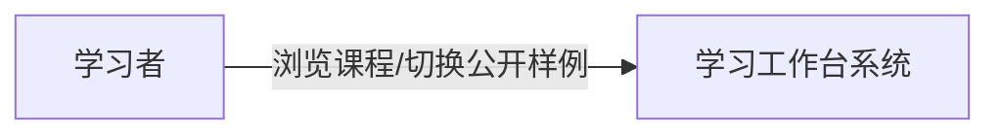
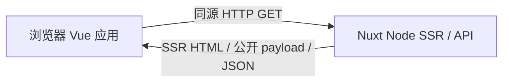
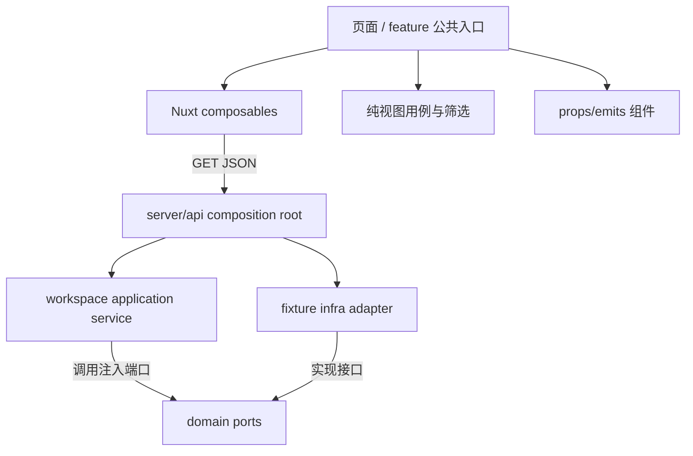

# 架构视图与依赖规则

C4只采用能帮助当前读者的层级。图和文字描述实际实现；C4 Container指应用/数据存储等运行单元，不专指Docker。当前没有真实远程上游或数据库。

## Context：系统与使用者

学习者使用公开合成目录；没有生产账号/第三方身份提供商。

## Container：运行单元与协议

SSR首次页面由Node生成，随后Vue接管；读取课程/进度的适配器是Nuxt进程内函数，不是图上另一个HTTP微服务。独立实验lab不属于主工作台生产拓扑。

## Component：调用与组装

这张图表达调用/组装关系。源码依赖另看下面规则：Service import Port，不import Adapter；API同时import服务与Adapter用于组装。调用实际执行Adapter，不表示core必须依赖具体实现。

## 目录和状态

- app/pages：路由入口/容器；只从catalog/index.ts访问feature公共能力。
- app/features/catalog/domain、application：纯筛选/视图规则，只依赖纯契约；composables是Nuxt适配层，components是props/emits展示组件。
- shared/contracts：公开序列化DTO与运行时解码，无服务器秘密/单例状态。
- server/features/workspace：domain定义端口，application验证必要DTO/组合可选结果，infra提供合成adapter；server/api负责HTTP输入/状态和组装。

useAsyncData key包含scope和可选失败情景；URL q只是已取课程的本地视图过滤，不改变远程数据所以不进请求key。input draft局部；useState收藏每应用创建并按scope:slug区分，不持久化，不是真实账号隔离。

## 有限门禁及限制

pnpm boundaries读取app/server/shared中的.ts及.vue script显式静态import、reexport、字面量import()/require，解析相对、~/和~~/路径，检查循环及core/客户端/server方向；计算import会报告需审查。类型依赖也计入保守图，可能严于运行时循环。

没有完整解析SFC外部script src、Nuxt自动导入与自动组件注入、生成代码、所有包exports/自定义alias、JS模块内部、运行时eval/插件网络、完整依赖安全。因此这只是本项目已声明源码约定的辅助，不是通用module resolver、完整FSD enforcement或安全沙箱；新增别名/扩展语言必须同步工具或选成熟依赖检查方案。

五项门禁回归覆盖正反例；真实项目图一起审。目录结构与图不会强制浏览器安全权限，服务端真实授权仍需独立实现。
