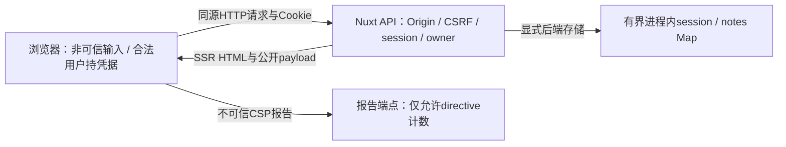

# 威胁模型：本地匿名安全笔记

范围：单个Nuxt Node进程+浏览器，公开教学匿名会话；无真实用户、密码、IdP、数据库、云部署。用STRIDE辅助提问，不强凑每处六类漏洞。

资产：随机会话Cookie、会话绑定CSRF token、各会话笔记、服务器配置、CSP策略/报告和依赖产物。Cookie是凭据，csrf允许合法页面JS读取并发送，不是登录身份。笔记文本只用合成内容。

信任边界：客户端字段/URL不能决定owner；脚本可读的数据不得当服务端秘密；浏览器同源不等于同站，Cookie不按端口隔离，本机不同服务也不能视为生产安全边界。Map是显式后端会话存储，不能换成一个共享currentUser保存当前SSR用户。

| 威胁与前提             | 控制/实际证据                                                      | 残余风险                                                                                           |
| ---------------------- | ------------------------------------------------------------------ | -------------------------------------------------------------------------------------------------- |
| 已知别人的note ID越权  | 每次读取/删除核session及owner；另一会话404、匿名401，原对象不变    | 匿名不验证真人，无真实account/tenant/role                                                          |
| 跨源自动带Cookie写操作 | 固定Origin精确比较、CSRF与session绑定，缺/错token或Origin403       | XSS可借当前会话发请求；CORS不是身份/CSRF控制                                                       |
| 文本进入HTML执行       | Vue插值纯文本、服务端text允许列表/长度；恶意标签不创建元素         | 未实现富HTML，未来加v-html须重新评审                                                               |
| nonce盲授权            | 框架nonce和TT；独立parser探针授权/拒绝对照                         | 模块40-cspSsrNonce regex给body等补nonce；若未信任SSR HTML已注入可能一并授权，不能代替安全输出/净化 |
| 会话伪造/固定/过期重放 | crypto随机32字节、HttpOnly/Lax、新建撤旧、logout删session及notes   | 本地Secure=false；生产HTTPS/Secure/前缀及持久会话另验                                              |
| 请求过大/属性篡改      | 模块声明长度8192+自己实际字节4096；真chunked6000B413，owner字段400 | 读截止和大流关闭非完整DoS/速率方案                                                                 |
| SSR/缓存混用           | cache:false/no-store，双会话SSR无交叉且Cookie原值不入HTML          | CDN/生产多副本未验                                                                                 |
| 报告收集敏感信息       | 只保留允许directive计数/每项100，URI/sample不存                    | 遥测可伪造，无时间TTL/生产反滥用与保留流程                                                         |
| 依赖与配置漂移         | 固定模块/锁文件、冻结安装及真实构建/浏览器                         | 独立lab audit不替代主全依赖/未知供应链审计                                                         |

会话15分钟后不能访问；过期记录在后续store.start/get访问时惰性清理，不承诺准点物理删除。退出立即撤销并删除笔记。进程重启全部丢失，不是生产备份/删除证明。

style-src兼容性允许unsafe-inline；TT/script nonce保持开启。COEP/HSTS在本地关闭，COOP/CORP同源；没有OAuth popup或跨源嵌入。rateLimiter/XSSvalidator/CORS中间件关闭，写接口有独立Origin/CSRF/允许列表，不能写模块全部能力已启用。

新增上传、第三方脚本、真实账号或富HTML前重新建模。已测fixture通过不等于全系统安全。
