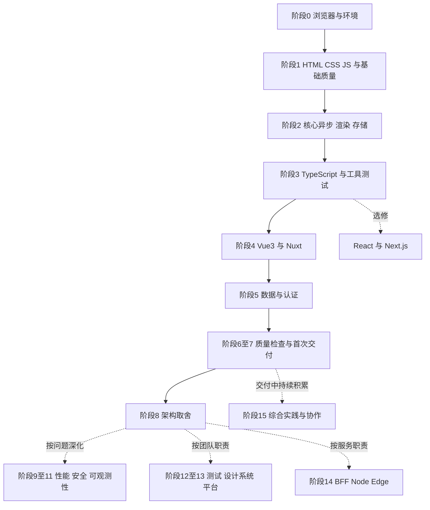

# Web 工程师知识地图

面向已有 Android / Flutter / React Native 经验的开发者。目标是逐步掌握 Web 原理、用户端产品开发与工程治理，默认技术主线为 **HTML/CSS/JavaScript → TypeScript → Vue 3 → Nuxt**。**React / Next.js 是选修**，不阻塞主线交付。

## 如何使用

- 先读[学习主线与阶段验收](./docs/LEARNING_PATH.md)，再在[六个分册](./knowledge-map/README.md)中查知识点。编号是稳定索引，不要求所有条目按数字顺序学完。
- 阶段 0–7 支持完成首个 Vue/Nuxt 产品；其中标为选修、维护选读的主题按需求学习。阶段 8–15 是深入工程专题，按项目问题与职责选择。
- 语义、无障碍、兼容、隐私、安全和测试从基础练习开始执行；后面的专项章负责深化，不是首次出现这些要求。
- 复选框由学习者记录；是否已编写正文与是否通过技术验收分别记录。查询当前覆盖率运行 `python3 scripts/check_knowledge.py --table`。
- 所有知识点使用稳定的三/四级序号。笔记与示例文件名对应序号；缺少正文的项是待建设内容，不能由链接或勾选推导质量。
- 高级能力通过真实项目、独立排障、技术取舍与可复核交付积累，不以读完目录、固定周数或单次示例运行保证职级。

## 路线总览

| 阶段 | 主题 | 定位与核心产出 |
| --- | --- | --- |
| 0 | 环境与心智模型 | 主线：能观察并解释浏览器请求、资源与错误 |
| 1 | Web 基础三件套及基础质量 | 主线：语义页面、宽窄布局、原生交互，贯穿兼容与无障碍 |
| 2 | JavaScript 深入与浏览器原理 | 主线核心先读，其他按需：理解异步、渲染、缓存和存储边界 |
| 3 | 工程化与 TypeScript | 主线：可复现的工具链、类型、代码检查与最小测试 |
| 4 | Vue 3 / Nuxt 与组件状态 | 主线：Vue → Nuxt；React/Next 跨生态选修 |
| 5 | API、认证与全栈协作 | 主线：数据校验、失败处理、会话与服务端授权边界 |
| 6 | 性能、安全与可访问性 | 首次交付的质量检查，并按目标深化相关专题 |
| 7 | 首次交付与渲染部署 | 主线闭环：构建、部署、深链刷新、配置、监测与回滚证据 |
| 8 | 架构与系统设计 | 深化：围绕真实需求解释模块、渲染、状态与 BFF 取舍 |
| 9 | 深度性能工程 | 深化：测量和验证性能瓶颈，不机械套用优化技巧 |
| 10 | 安全工程与隐私 | 深化：威胁建模、认证、供应链与适用的合规协作 |
| 11 | 可观测性与生产运维 | 深化：错误、指标、发布与事故排查能力 |
| 12 | 测试策略与设计系统 | 按职责：复杂测试策略、组件契约与设计系统 |
| 13 | 平台化工程 | 按团队规模：多包、依赖发布与开发体验治理 |
| 14 | BFF / Node / Edge 运行时 | 按服务职责：Nuxt/Nitro 深化；独立 BFF、Edge 按需 |
| 15 | 项目整合、治理与工程管理 | 综合交付与协作；特定平台、组织管理按岗位选择 |

阶段编号不是严格时间线：例如 1.4 的质量要求从 1.1 起使用，4.3.3.1 单文件组件先于 Vue API 练习，Nuxt 数据/渲染基础在阶段 4 学习，阶段 7 再做部署专项。关键的安全和配置检查不能因其深入专题编号较大而推迟。
